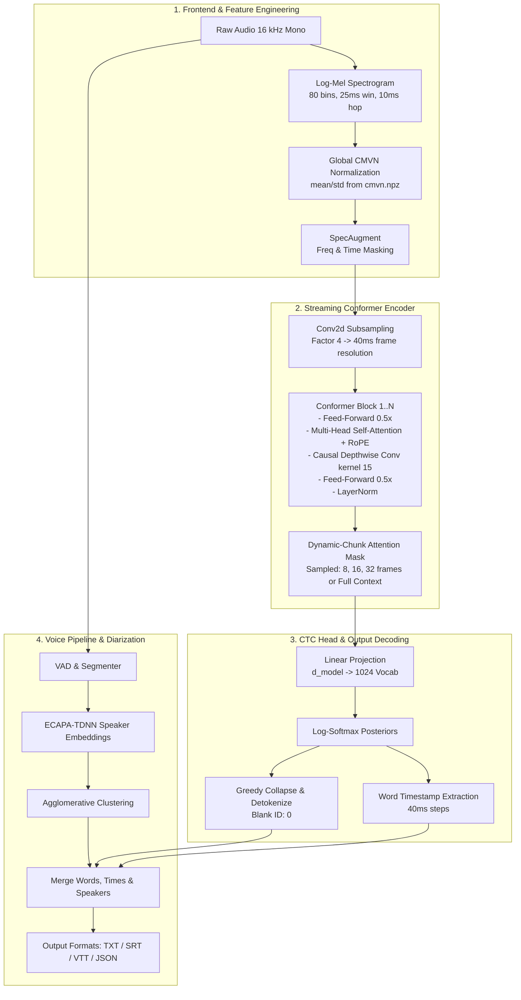

<div align="center">

# 🎙️ AWAAZ (ਆਵਾਜ਼)
### Edge Speech-to-Text & Voice Intelligence System for English and Punjabi

[](https://opensource.org/licenses/Apache-2.0)
[](https://python.org)
[](docs/SPEC.md)
[](docs/EDGE.md)
[%20%2B%20Latin-red.svg)](docs/phases/PHASE_01_TEXT_NORMALIZATION_TOKENIZER.md)
[](https://github.com/astral-sh/ruff)

*A small, streaming-capable bilingual Automatic Speech Recognition (ASR) system built from scratch in PyTorch, engineered specifically for smartwatches, mobile phones, and embedded edge devices.*

[Architecture](#-system-architecture) •
[Presets](#-model-presets) •
[Quickstart](#-quickstart) •
[Sacred-Text Policy](#-sacred-text-policy-15) •
[Pipeline](#-multi-stage-pipeline) •
[14-Phase Spec](#-project-roadmap--14-phase-spec) •
[Documentation](#-documentation-index)

</div>

---

## 🌟 Executive Summary

**Awaaz (ਆਵਾਜ਼)** is an open-source, resource-efficient speech recognition and voice intelligence pipeline designed to transcribe both **English** and **Punjabi (Gurmukhi script)** — including natural bilingual code-switching.

While modern cloud speech models require billions of parameters and gigabytes of memory, **Awaaz models range from ~6M to ~55M parameters (~6 MB to ~55 MB quantized in int8)**. With our unified **Dynamic-Chunk Streaming Conformer-CTC** architecture, a single trained checkpoint operates both as an instantaneous, low-latency live streaming transcriber on wearable devices and as a high-accuracy full-context offline speech engine.

```
Live Audio (16 kHz) ──► 80-bin Mel + CMVN ──► Factor-4 Conv2d ──► RoPE Conformer ──► CTC Greedy / Diarization ──► Transcript
```

---

## 🚀 Key Technical Highlights

1. **Trained From Scratch (Zero Monolithic Pretrained Dependencies)**:
   Implemented purely in PyTorch with custom 2D convolution subsampling, rotary positional embeddings (RoPE), Macaron-style Conformer blocks, causal depthwise convolutions, and a linear CTC head.
2. **Unified Offline & Low-Latency Streaming**:
   Trained with dynamic chunk masking ($0.32\text{s}$, $0.64\text{s}$, and $1.28\text{s}$ chunks). Enables on-device sliding-window streaming with zero latency penalty and deterministic offline transcription from one set of weights.
3. **True Bilingual Gurmukhi + English Representation**:
   Shared 1024-token SentencePiece unigram vocabulary strictly balanced 50/50 between English and Punjabi corpora. Gurmukhi character coverage is fixed at 1.0. Token ID 0 is reserved as the CTC blank.
4. **Edge Hardware Footprint**:
   Exports directly to ONNX (opset $\ge 17$) and int8 dynamic quantization with $< 10^{-3}$ numerical parity tolerance, achieving real-time factor $RTF \le 0.4$ on ultra-low-power ARM Cortex-A53 / Snapdragon W5+ smartwatch platforms.
5. **Multi-Stage Production Voice Intelligence**:
   Modular pipeline coupling Voice Activity Detection (VAD), Conformer ASR, speaker diarization (clustering acoustic embeddings), speech enhancement / denoising, and automated SRT/VTT/JSON subtitle generation.
6. **Ethical Sacred-Text Policy (§1.5)**:
   Strict protocol excluding religious recitations (Gurbani, kirtan, katha) from generic acoustic modeling to preserve scriptural integrity and eliminate synthetic distortions.

---

## 📐 System Architecture



---

## 📊 Model Presets

All presets utilize causal depthwise convolutions (kernel size 15), subsampling factor 4, and 80-bin Mel features.

| Preset | $d_{\text{model}}$ | Blocks | Heads | FFN Dim | Parameters | int8 Size | Target Devices & Latency |
|---|---|---|---|---|---|---|---|
| **`tiny`** | 144 | 12 | 4 | 576 | **~6 Million** | **~6 MB** | Smartwatches (Wear OS / watchOS), ultra-low-power IoT ($RTF \le 0.4$) |
| **`small`** | 256 | 12 | 4 | 1024 | **~19 Million** | **~19 MB** | Smartphones (Android / iOS), Raspberry Pi 4/5 ($RTF \le 0.25$) |
| **`base`** | 384 | 16 | 6 | 1536 | **~55 Million** | **~55 MB** | Edge servers, desktop, high-accuracy transcription ($RTF \le 0.15$) |

---

## ⚡ Quickstart

### 1. Installation

```bash
# Clone the repository
git clone https://github.com/Paramveersingh-S/Awaaz.git
cd Awaaz

# Create virtual environment
python -m venv .venv
source .venv/bin/activate  # On Windows: .venv\Scripts\activate

# Install core package
pip install -e .

# Or install with all optional dependencies (pipeline, export, dev)
pip install -e .[all]
```

### 2. Generate Local Synthetic Fixture (< 30s)

Awaaz strictly follows the **weak dev machine rule** (Rule 4 of `AGENTS.md`). All local development and unit tests execute against tiny, lightning-fast synthetic fixtures without needing external dataset downloads:

```bash
python scripts/make_fixture.py --output_dir tests/fixtures/synthetic
```

### 3. Run Test Suite

```bash
pytest -v
```

### 4. Interactive Web Demo (Gradio)

Launch the interactive local web application for live microphone streaming, file transcription, and multi-format subtitle export:

```bash
python app/app.py --port 7860
```
Open `http://localhost:7860` in your browser.

### 5. CLI Transcription & Live Streaming

```bash
# Offline transcription of an audio file
awaaz transcribe sample.flac --format srt

# Multi-speaker transcription with diarization and track export
awaaz transcribe meeting.wav --diarize --speakers 2 --format json --export-tracks ./output_tracks/

# Real-time streaming recognizer simulation
awaaz stream --audio sample.flac --chunk_ms 640

# Manifest evaluation against reference transcripts
awaaz evaluate --manifest manifests/test.jsonl
```

---

## 📜 Sacred-Text Policy (§1.5)

Public Punjabi audio frequently contains religious kirtan, katha, and Gurbani recitation. General-purpose ASR systems trained on broad conversational speech can subtly mis-transcribe or hallucinate sacred text. In theological contexts, a plausible wrong transcript is unacceptable.

Therefore, Awaaz enforces an explicit sacred-text policy across all code and data components:
- **Manifest Tagging**: All manifests carry an optional `domain` field. Any clip containing devotional recitation or scripture is explicitly tagged `"domain": "sacred"`.
- **Exclusion by Default**: Version 1 models strictly **exclude all `sacred` clips** from training, validation, and testing splits (`exclude_sacred: true`).
- **No Automated Alteration**: No automated rewriting, correction, or summarization of sacred texts is permitted anywhere in the pipeline.
- **Dedicated Future Roadmap**: Any future support for Gurbani recitation must be developed as an isolated, opt-in, scholar-reviewed model.

---

## 🔄 Multi-Stage Pipeline

Awaaz features a modular voice processing suite under `awaaz/pipeline/`:

1. **Voice Activity Detection (`awaaz.pipeline.vad`)**: Detects human speech bursts, applies 0.15s padding, and performs energy-aware chunk splitting at the quietest local boundary near 20 seconds.
2. **Conformer ASR (`awaaz.model`)**: Transcribes acoustic chunks using bilingual dynamic-chunk attention.
3. **Speaker Diarization (`awaaz.pipeline.diarize`)**: Extracts speaker embeddings using pretrained acoustic encoders and clusters speaker turns via Agglomerative Hierarchical Clustering.
4. **Audio Smoothing (`awaaz.pipeline.enhance`)**: Applies high-fidelity speech denoising (`LightweightEnhancer` or DeepFilterNet) for clean listening playback.
5. **Overlapped-Speech Separation (`awaaz.pipeline.separate`)**: Identifies multi-speaker collisions and provides dual-stream decoding.
6. **Timeline Alignment (`awaaz.pipeline.merge`)**: Matches CTC token emission spikes to speaker windows and formats output into readable paragraphs, SRT/VTT subtitles, or structured JSON.

---

## 🗺️ Project Roadmap & 14-Phase Spec

The project execution is broken into 14 distinct, self-contained specifications:

| Phase | Milestone | Specification | Output & Status |
|---|---|---|---|
| **Phase 0** | Repo Bootstrap | [PHASE_00.md](docs/phases/PHASE_00_REPO_BOOTSTRAP.md) | Skeleton, Packaging, CI, Synthetic Fixture (COMPLETED) |
| **Phase 1** | Text Normalization & Tokenizer | [PHASE_01.md](docs/phases/PHASE_01_TEXT_NORMALIZATION_TOKENIZER.md) | Deterministic NFC Normalizer, 1024-Vocab SentencePiece (COMPLETED) |
| **Phase 2** | Audio Features & Augmentation | [PHASE_02.md](docs/phases/PHASE_02_AUDIO_FEATURES_AUGMENTATION.md) | 80-bin Mel, Global CMVN, SpecAugment, Waveform Augmenters (COMPLETED) |
| **Phase 3** | Data Pipeline | [PHASE_03.md](docs/phases/PHASE_03_DATA_PIPELINE.md) | JSONL Manifests, Duration-Bucketed Sampler, Balancing Tool (COMPLETED) |
| **Phase 4** | Conformer-CTC Model | [PHASE_04.md](docs/phases/PHASE_04_MODEL.md) | PyTorch Conformer-CTC, RoPE Attention, Causality Tests (COMPLETED) |
| **Phase 5** | Training Loop | [PHASE_05.md](docs/phases/PHASE_05_TRAINING_LOOP.md) | Resumable Dynamic-Chunk Trainer, Warmup-Cosine, Atomic Saves (COMPLETED) |
| **Phase 6** | Colab Runner & Cloud Sync | [PHASE_06.md](docs/phases/PHASE_06_COLAB_RUNNER_PERSISTENCE.md) | GPU Cloud Notebooks, Drive Persistence, Checkpointing (COMPLETED) |
| **Phase 7** | Evaluation & Decoding | [PHASE_07.md](docs/phases/PHASE_07_EVALUATION_DECODING.md) | WER/CER Evaluator, CTC Timestamps, Checkpoint Averaging (COMPLETED) |
| **Phase 8** | Streaming Inference | [PHASE_08.md](docs/phases/PHASE_08_STREAMING_INFERENCE.md) | Real-time Sliding Window Recognizer, Latency Accounting (COMPLETED) |
| **Phase 9** | Export, Quantization & Edge Budget | [PHASE_09.md](docs/phases/PHASE_09_EXPORT_QUANTIZATION_EDGE.md) | ONNX Export (opset 18), int8 Dynamic Quantization, Parity Kit (COMPLETED) |
| **Phase 10** | Full Multi-Stage Pipeline | [PHASE_10.md](docs/phases/PHASE_10_FULL_PIPELINE.md) | VAD, Speaker Diarization, Denoising, Unified CLI (COMPLETED) |
| **Phase 11** | Optional v2 Enhancer & Separation | [PHASE_11.md](docs/phases/PHASE_11_OPTIONAL_V2_MODELS.md) | Sub-500k Param Enhancer, Overlapped-Speech Separator (COMPLETED) |
| **Phase 12** | Demo, Documentation & Release | [PHASE_12.md](docs/phases/PHASE_12_DEMO_DOCS_RELEASE.md) | Gradio Web App on Hugging Face Spaces, Model Card, Tags (COMPLETED) |
| **Phase 13** | Edge Applications | [PHASE_13.md](docs/phases/PHASE_13_EDGE_APPS.md) | Wear OS (Kotlin), iOS (Swift), and Web (Wasm) Reference Apps |

---

## 📚 Documentation Index

- **Master Specification**: [`docs/SPEC.md`](docs/SPEC.md)
- **Model Card & Ethical Disclosures**: [`docs/MODEL_CARD.md`](docs/MODEL_CARD.md)
- **Living Progress Log**: [`docs/PROGRESS.md`](docs/PROGRESS.md)
- **Architecture Decision Records (ADRs)**: [`docs/DECISIONS.md`](docs/DECISIONS.md)
- **Edge Deployment & Hardware Budget**: [`docs/EDGE.md`](docs/EDGE.md)
- **Streaming Latency & Cache Spec**: [`docs/STREAMING.md`](docs/STREAMING.md)
- **v2 Enhancement & Separation**: [`docs/SEPARATION.md`](docs/SEPARATION.md)
- **Language-Neutral Audio Features Spec**: [`docs/FEATURES.md`](docs/FEATURES.md)
- **Training & VRAM Budgeting Guide**: [`docs/TRAINING.md`](docs/TRAINING.md)
- **TPU / JAX Migration Roadmap**: [`docs/TPU.md`](docs/TPU.md)
- **Dataset License Registry**: [`DATA_LICENSES.md`](DATA_LICENSES.md)
- **Contributing Guidelines**: [`CONTRIBUTING.md`](CONTRIBUTING.md)
- **Code of Conduct**: [`CODE_OF_CONDUCT.md`](CODE_OF_CONDUCT.md)
- **Security Policy**: [`SECURITY.md`](SECURITY.md)

---

## 🤝 Contributing

We welcome contributions from researchers, linguists, and mobile engineers interested in low-resource speech technology and edge AI. Please review [`CONTRIBUTING.md`](CONTRIBUTING.md) and [`CODE_OF_CONDUCT.md`](CODE_OF_CONDUCT.md) before submitting pull requests.

---

## ⚖️ License

Awaaz code is distributed under the **Apache-2.0 License**. See [LICENSE](LICENSE) for full details. Model weights are released under licenses corresponding to their underlying training corpora as detailed in [`DATA_LICENSES.md`](DATA_LICENSES.md).
