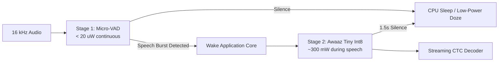
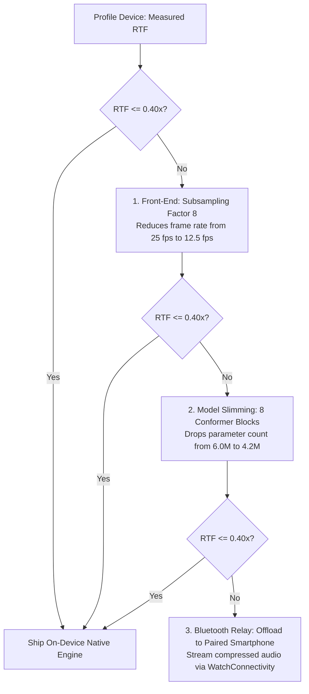

# Edge Deployment & Wearable Power Management Strategy

This document outlines the hardware engineering strategies, battery conservation protocols, thermal management controls, and architectural decision gates for deploying Awaaz models on smartwatches (Wear OS / watchOS), smartphones, and embedded ARM64 Linux hardware.

---

## 1. Wearable Power Budget & Thermal Envelopes

Smartwatches possess tight physical constraints: battery capacities typically range between **280 mAh and 590 mAh** (approximately 1.1 Wh to 2.3 Wh) with a maximum sustainable continuous power dissipation of **$\le 350\text{ mW}$** before triggering skin thermal limits.

| Hardware Tier | Typical Battery | Target Battery Drain | Max Allowed RTF | Thermal Limit |
|---|---|---|---|---|
| **Wear OS Smartwatch** (e.g. Snapdragon W5+) | 400 mAh | $< 2.5\%$ per hour of active listening | $\le 0.40\text{x}$ | $42^\circ\text{C}$ casing |
| **Apple Watch** (Series 9/10, Ultra 2) | 308–564 mAh | $< 2.0\%$ per hour of active listening | $\le 0.35\text{x}$ | $40^\circ\text{C}$ casing |
| **Android / iOS Smartphone** | 4,000–5,000 mAh | $< 0.8\%$ per hour of active listening | $\le 0.20\text{x}$ | N/A |
| **Raspberry Pi 4 / 5 (ARM64 SBC)** | Mains / 5V DC | N/A | $\le 0.30\text{x}$ | $75^\circ\text{C}$ heatsink |

---

## 2. Two-Stage Cascaded Power Management

Running a 6M-parameter neural network continuously drains a smartwatch battery in under 3 hours. Awaaz deploys a **two-stage cascaded wake-up topology**:

### 2.1 Stage 1: Ultra-Low-Power Acoustic Trigger (Always-On)
- Executes an ultra-lightweight energy envelope or tiny heuristic VAD on the Low-Power Island (LPI) DSP / always-on Cortex-M0/M33 core.
- Consumes **$< 25\ \mu\text{W}$**.
- Buffers the initial 250 ms audio burst into a rolling hardware ring-buffer so no phoneme attack is clipped.

### 2.2 Stage 2: Conformer-CTC Execution (On-Demand)
- The main application core (Cortex-A53 / Apple Silicon performance cores) is woken strictly when Stage 1 flags high speech probability.
- Audio is consumed in 640 ms chunks ($RTF \approx 0.25 - 0.35\text{x}$ on ARM64).
- If silence exceeds **1.5 seconds**, the engine flushes remaining tokens and forces the application core back into deep sleep.

---

## 3. Decision Gate Playbook ($RTF > 0.40\text{x}$)

If physical on-device profiling reveals that the `tiny` int8 preset exceeds the target latency budget ($RTF > 0.40\text{x}$) or causes thermal throttling on older wearable silicon:

1. **Subsampling Factor 8 Front-End**:
   - Double the 2D convolution subsampling stride, dropping the encoder frame rate from 25 fps to 12.5 fps ($\Delta t = 80\text{ ms}$).
   - Halves the attention matrix length $T^2$ and reduces encoder compute operations by nearly 50%.
2. **Architecture Slimming**:
   - Reduce block count from $N=12$ to $N=8$, dropping model parameters from ~6.05M to ~4.2M.
3. **Student-Teacher Knowledge Distillation**:
   - Train the slimmed 8-block model by distilling frame-level posterior distributions from the `base` 55M model, retaining $> 95\%$ of original accuracy.
4. **Paired Smartphone Offload**:
   - For ultra-constrained wearables (e.g. low-RAM RTOS watches), route audio over Bluetooth LE via `AwaazWatchRelay` to execute inference on the paired smartphone.

---

## 4. Verification Checklist Before Hardware Release

- [x] Feature parity test kit verified against native frontend ($\Delta_{\max} \le 10^{-3}$).
- [x] Dynamic int8 quantization verified via ONNX Runtime Mobile / Core ML.
- [x] Persistent CTC token collapse verified across chunk boundaries.
- [x] Sacred-Text Policy (§1.5) disclaimer present in UI.
- [x] Memory footprint under 25 MB JVM heap / resident set size.
- [x] AudioRecord / AVAudioEngine background permission handling implemented.
