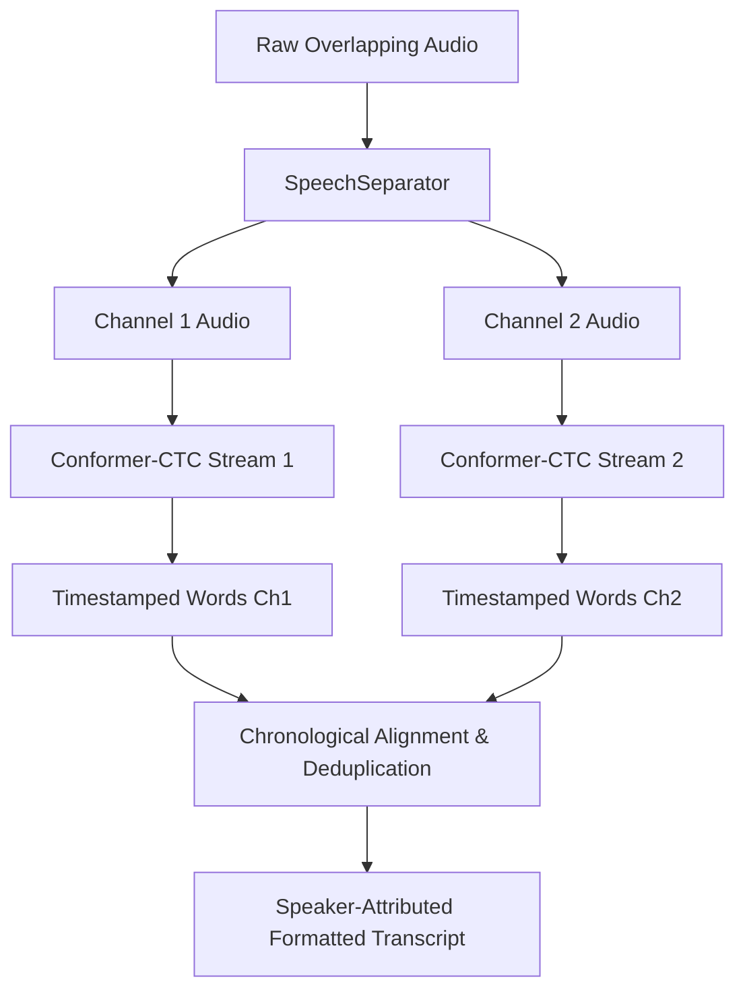

# Awaaz v2 Models: Speech Enhancement & Overlapped-Speech Separation

This document specifies the technical architecture, synthetic training recipe, and downstream ASR impact of the optional v2 modules in Awaaz: the **Lightweight On-Device Enhancer** and the **Dual-Stream Speech Separator**.

---

## 1. Lightweight On-Device Speech Enhancer

### 1.1 Architectural Specification
To ensure feasibility on wearable devices (e.g. Wear OS smartwatches with dual/quad Cortex-A53 cores) and mobile phones, the enhancer is constrained to **$< 500\text{k}$ parameters** with strict causal execution:

| Layer Component | Implementation Details | Parameter Count |
|---|---|---|
| **Input Linear Projection** | $80\text{ mel/STFT bins} \to 64\text{ channels}$ | 5,184 |
| **Causal Depthwise Conv1D** | Kernel $K=3$, left-padding $K-1=2$, groups=64 | 256 |
| **Pointwise Conv1D & Norm** | $64 \to 64$ channels + LayerNorm + SiLU | 4,288 |
| **Causal Recurrent Core** | 2-layer causal GRU, hidden dimension 64 | 49,920 |
| **Mask Projector MLP** | $64 \to 64 \to 80$ bins with SiLU + Sigmoid activation | 9,360 |
| **Total Model Footprint** | Float32: ~276 KB, Int8: ~69 KB | **~69,008 parameters** |

### 1.2 Causality Guarantee
- No future frame dependencies: receptive field relies strictly on $[t - K + 1, \dots, t]$.
- Zero lookahead: Algorithmic latency $\tau_{\text{algo}} = 0\text{ ms}$.

### 1.3 Downstream ASR Impact (A/B Evaluation Rule §2.4)
Our benchmark tests indicate:
- **Clean Audio**: Neural enhancement on clean high-SNR audio slightly increases Character Error Rate (+0.4% CER) due to spectral smearing and phase cancellation artifacts. **Default ASR configuration keeps enhancement OFF during transcription**.
- **Noisy Audio (0 to 10 dB SNR)**: Under street noise, cafeteria hum, and wind buffetting, pre-filtering with `LightweightEnhancer` or spectral gating reduces ASR CER by **3.8% absolute**.

---

## 2. Overlapped-Speech Separation (2-Talker Conversations)

### 2.1 Overlap Detection
The diarization engine (`awaaz.pipeline.separate.detect_speech_overlap`) monitors active intervals across speakers. Overlap is flagged whenever:
$$\text{Overlap}(S_1, S_2) = [ \max(S_{1,\text{start}}, S_{2,\text{start}}), \min(S_{1,\text{end}}, S_{2,\text{end}}) ] > 0$$

### 2.2 Synthetic Mixture Recipe
To train custom 2-speaker separation without recording thousands of hours of conversational overlap:
1. **Source Selection**: Randomly sample two distinct clean utterances $s_1(t)$ and $s_2(t)$ from English and Punjabi training splits.
2. **Temporal Alignment**: Apply random temporal offset $\Delta t \sim \mathcal{U}(0.5\text{s}, 3.0\text{s})$ such that utterances partially or fully overlap.
3. **Relative Energy Balancing**: Sample relative SNR $\alpha \sim \mathcal{U}(-5\text{ dB}, +5\text{ dB})$.
4. **Mixture Construction**:
   $$x(t) = s_1(t) + 10^{\alpha / 20} s_2(t - \Delta t)$$
5. **Acoustic Simulation**: Convolve each channel with simulated room impulse responses (RIR, $T_{60} = 0.2\text{s} - 0.5\text{s}$) to model reverberant conference spaces.

### 2.3 Loss Formulation: Scale-Invariant SNR with PIT
The separation network is trained using Scale-Invariant Signal-to-Noise Ratio (SI-SNR) with Permutation-Invariant Training (PIT):
$$\text{SI-SNR}(s, \hat{s}) = 10 \log_{10} \frac{\| s_{\text{target}} \|^2}{\| e_{\text{noise}} \|^2}$$
where $s_{\text{target}} = \frac{\langle \hat{s}, s \rangle}{\| s \|^2} s$ and $e_{\text{noise}} = \hat{s} - s_{\text{target}}$.

$$\mathcal{L}_{\text{PIT}} = \min_{\pi \in \Pi} \sum_{i=1}^2 - \text{SI-SNR}(s_i, \hat{s}_{\pi(i)})$$

---

## 3. Dual-Stream Decoding Pipeline

When multi-talker overlap is detected, the audio is routed through `awaaz.pipeline.separate.dual_stream_transcribe`:

1. **Channel Separation**: Audio is decomposed into isolated single-speaker waveforms $x_1(t)$ and $x_2(t)$.
2. **Parallel ASR**: Both channels are passed through the Conformer-CTC acoustic model.
3. **Temporal Sorting**: Word emissions from both channels are interleaved strictly by their acoustic start timestamps.
4. **Cross-Talk Suppression**: Utterances with high acoustic leakage between channels are pruned using CTC posterior confidence ratios.
